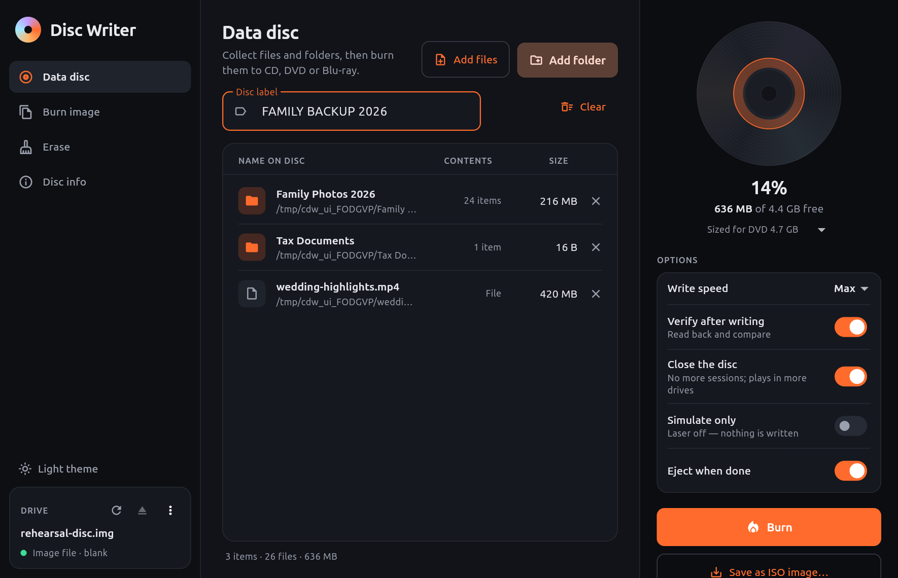

# Disc Writer

A clean, modern disc-burning app for Linux desktop. Disc Writer burns data
CDs, DVDs and Blu-ray discs, writes ISO images, saves projects as ISO files
and erases rewritable media. All the burning is done by
[xorriso](https://www.gnu.org/software/xorriso/), the libburnia tool. Disc
Writer drives the `xorriso` command line and doesn't link any burning library.

Built with Flutter (Linux desktop) and Riverpod.



## Features

**Data discs.** Drop in files and folders, or add them with the pickers, and
set a volume label. A capacity bar shows live how full the disc will be. It
uses the free space reported by the inserted disc, or a CD / DVD / DVD DL /
BD preset when no disc is present. Before writing, xorriso's `-print_size`
computes the exact image size, so an over-full project fails before it uses
up a write-once disc.

**Multi-session.** When a disc is still open, new files go into a new
session next to the existing ones, which stay visible. Turning on "Close the
disc" finalises it so it reads in more (and older) drives.

**Verification.** Every data burn records session MD5 checksums. Afterwards
the disc is read back and checked against them. When you burn an image file,
the disc is compared byte for byte with the image instead, because most
downloaded ISOs carry no recorded MD5.

**Burn image.** Writes `.iso` and `.img` files verbatim, so bootable
installers stay bootable. ISO 9660 images show their volume label before you
burn.

**Save as ISO.** Writes the project to an ISO file with Joliet (Windows),
Rock Ridge (Unix) and ISO level 3 (single files larger than 4 GiB).

**Erase.** Quick or full erase for CD-RW, DVD±RW, DVD-RAM and BD-RE.

**Simulate.** Runs any burn or erase with the laser off.

**Image file as a drive.** Drive menu → *Use an image file as a drive…*
makes a file behave like a blank rewritable disc. Every burn, append, verify
and erase works on it exactly as on real media. Use it to rehearse a burn,
or to develop without hardware.

**Light and dark themes.** It follows the desktop by default, and the toggle
in the sidebar overrides that.

**Safe cancelling.** You can stop at any point. While the drive is writing,
the app warns first that stopping usually ruins a write-once disc.

## Install

**Snap** (bundles xorriso):

```bash
sudo snap install discwriter
sudo snap connect discwriter:optical-drive
```

The second command gives the snap write access to your optical drive. Snaps
don't connect that permission automatically.

**Ubuntu PPA** (Ubuntu 24.04):

```bash
sudo add-apt-repository ppa:dhiva-labs/apps
sudo apt install discwriter
```

**.deb**: download `discwriter_<version>_amd64.deb` from the
[releases page](https://github.com/Dhiva-Labs/DiscWriter/releases), then:

```bash
sudo apt install ./discwriter_*_amd64.deb
```

## Requirements

- Linux with an optical drive (internal or USB)
- `xorriso` (`sudo apt install xorriso`)
- Membership of the `cdrom` group so the drive can be opened:
  `sudo usermod -aG cdrom $USER`, then log out and back in. If xorriso can't
  open a drive the kernel can see, the Disc info page tells you so.

Disc Writer looks for xorriso in `$CD_WRITER_XORRISO`, then in the snap's
bundled copy, then on `PATH`.

## Building

```bash
flutter pub get
flutter build linux --release
```

The bundle lands in `build/linux/x64/release/bundle/`. Packaging:

- `packaging/build_deb.sh` builds the `.deb` from the release bundle
- `snapcraft pack --use-lxd` builds the snap; see [packaging/SNAP.md](packaging/SNAP.md)
- the Launchpad PPA is built offline from vendored inputs; see
  [packaging/PPA.md](packaging/PPA.md)
- `python3 tool/make_icon.py` regenerates the app icon

## Tests

```bash
flutter test                                  # unit + xorriso end-to-end
flutter test integration_test -d linux        # full UI flow + screenshots
```

The unit tests cover the xorriso output parsers, the exact argv of every
invocation and the project model. The end-to-end tests in
`test/integration/` run the real xorriso against file-backed drives. They
burn and verify a project, append a second session, save an ISO and burn it
with a byte comparison, detect a deliberately corrupted disc, reject an
over-full project before writing, erase, and cancel a running burn. The
integration test drives the real app window: it adds content, presses
**Burn**, waits for verification, inspects the disc and erases it. It also
writes the images in `screenshots/`.

If xorriso isn't on `PATH`, point `CD_WRITER_XORRISO` at a binary. Without
one, the end-to-end tests are skipped.

## Layout

```
lib/burn/       xorriso runner, output parsers, argv builders, job runner
lib/project/    the data-disc project model (entries, sizes, validation)
lib/state/      Riverpod providers (drives, media, project, job)
lib/ui/         shell, drive bar, pages, progress dialog
```

## License

MIT — see [LICENSE](LICENSE).
